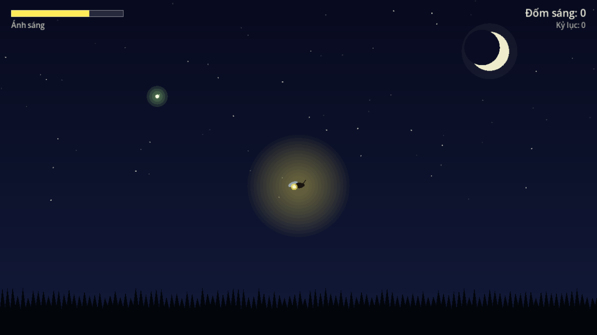
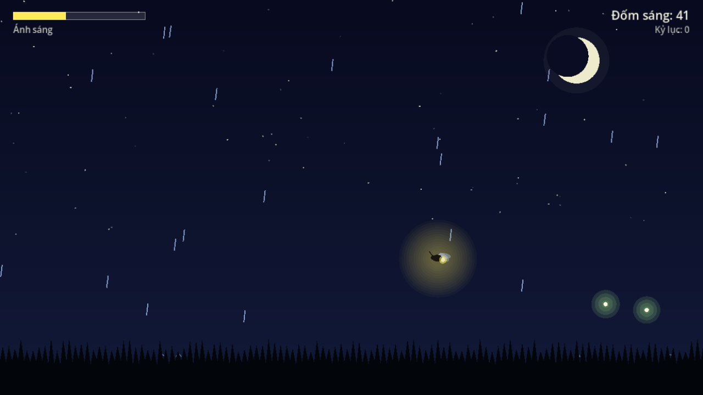
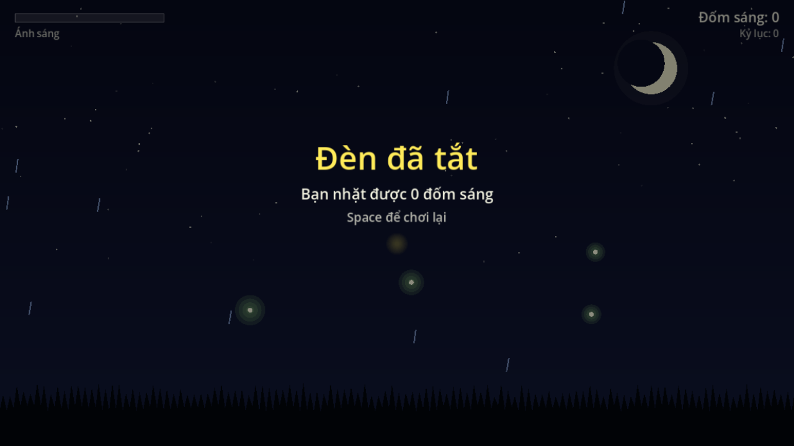
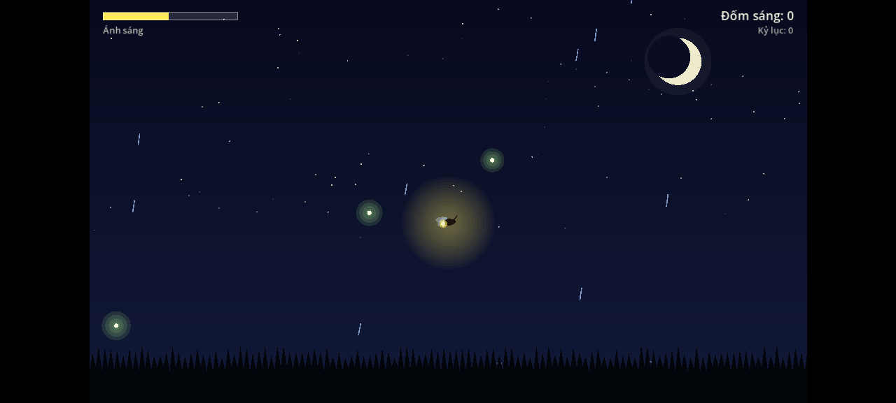

# Evidence — firefly slice (design/game-brief.md, Build order step 1)

Engine: Godot 4.7.2 (Compatibility renderer), 2026-11-16.

| Shot | How it was captured | What it shows |
|---|---|---|
|  | `godot --path . --write-movie … --quit-after 30` | Title screen, Vietnamese text renders, firefly + halo |
|  | `… --quit-after 3600 -- --demo --seed=7` | 60 s into an autopilot run: 41 motes, rain dense, light ~40% |
|  | `… --quit-after 600 -- --idle --seed=3` | Idle run dies at 5.4 s → "Đèn đã tắt" overlay with restart hint |

Unit tests: `godot --headless --path . -s res://tests/run_tests.gd` → 9 passed, 0 failed.

Run result: OBSERVED — title, play and game-over screens launched and looked at.
Not verified by a human: feel of the controls and difficulty (the demo autopilot dodges well, a person may find it harder).

## Exported builds (2026-11-16)

| Shot | How | What it shows |
|---|---|---|
|  | `make export-web`, then `make smoke-web` (HTTP + headless Chrome, Space pressed) | Exported Web build loads (WebGL 2, single-threaded) and plays |

Linux export run headless with `--fixed-fps 60 -- --idle --seed=3` → `Run over: 0 motes in 5.4 s`, same as the editor: the packed config loads.
Windows build: exported, not run (no Windows machine).
