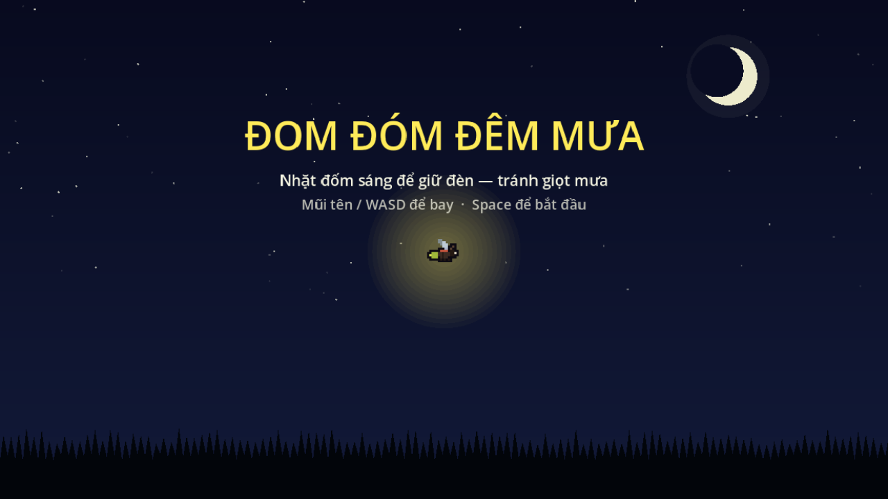
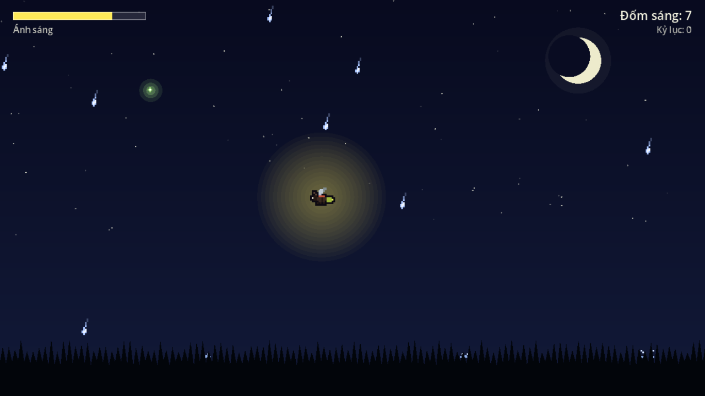
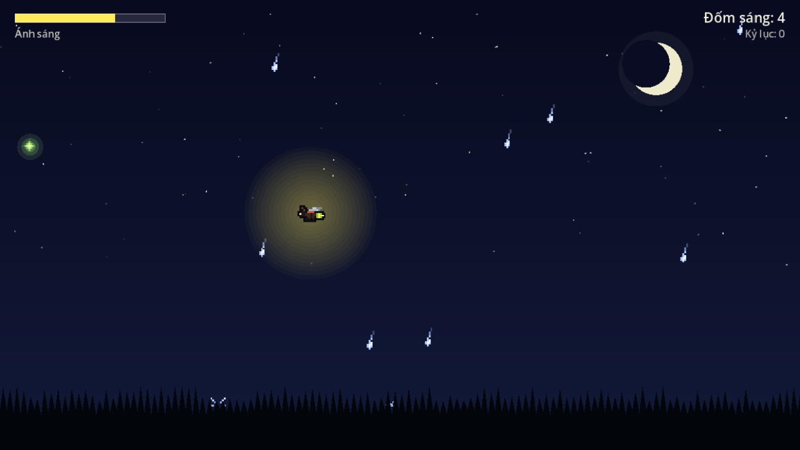
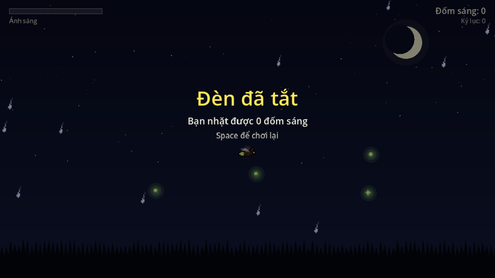
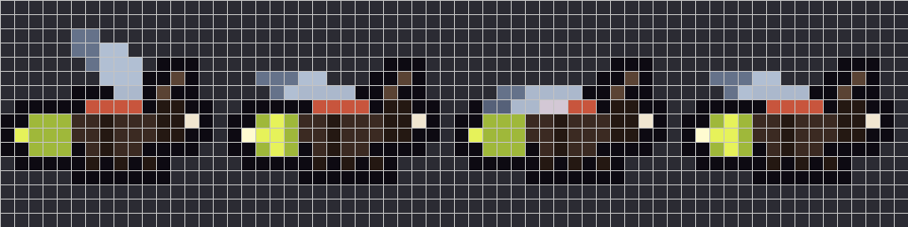
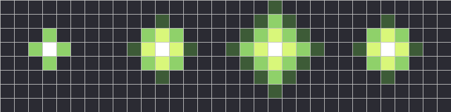
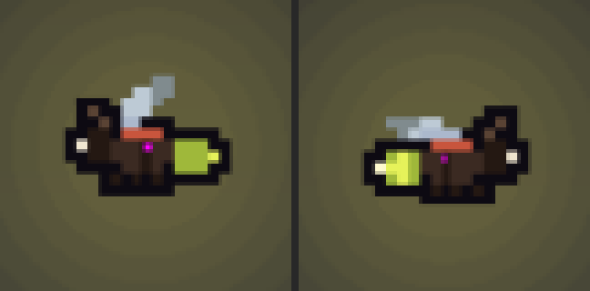
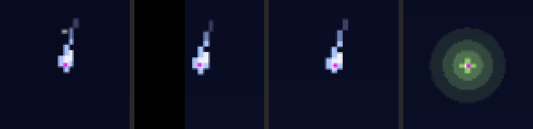

# Evidence: pixel-art sprite upgrade (2026-11-16)

Creatures and rain switched from drawn shapes to pixel-art strips made with `gamekit art`
(generators in `assets/source/sprites/<name>/gen.py`), shown at 3x with the Nearest filter.

| Shot | How | What it shows |
|---|---|---|
|  | `gamekit shot . "" 40` | title: firefly sprite facing right, centred in its halo |
|  | `gamekit shot . "" 600 -- --demo --seed=7` | 10 s demo: firefly mirrored while flying left, halo centred, motes, slanted rain, splashes at the grass |
|  | `gamekit shot . "" 400 -- --demo --seed=11` | second seed, same checks |
|  | `gamekit shot . "" 480 -- --idle --seed=3` | game over overlay over the sprites (run ends at 5.4 s, same as before) |
|     | `gamekit art run . <name>` previews | every frame of every sprite |

Found and fixed while shooting: the mirrored firefly was drawn 48 px (one sprite width) right of its
halo, because the flip moved the rect's origin as well as negating its width; motes were too faint.

Tests: `gamekit test`: 19 passed, 0 failed (3 new in tests/integration/sprites; the frame-count check
was watched failing with a wrong `frames` value before it was trusted).

Run result: OBSERVED. Not verified by a human: whether 3x reads well on a large monitor.

## Anchor fix (same day, after the user noticed sprites sat slightly off centre)

Measured: sprites were centred on their canvas, not on their content. The mote's 7 px shape sat in
an 8x8 canvas (1.5 screen px up-left of its own glow); the firefly's content centre was 0.5 source px
left of canvas centre, so it jumped 3 screen px each time it turned around.
Now every sprite has an `anchor` (source pixels) in the `sprites` config and is drawn through
`SpriteAnchor.dest_rect`, which mirrors the anchor when the sprite is flipped; positions snap to whole
screen pixels.

| Shot | What it shows |
|---|---|
|  | `--debug-anchors`, 4x zoom: the anchor dot sits on the body centre flying left (demo) and right (title) |
|  | anchor on each drop's head; on the mote's centre, inside its glow |
|  | normal play, same seed as 02 |

Tests: 23 passed, 0 failed. The two flip tests in tests/unit/sprite_anchor failed against the old
logic (anchor not mirrored: "moved from (100, 200) to (103, 200)") before the fix.
