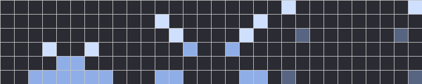

# Evidence: pixel-art sprite upgrade (2026-11-16)

Creatures and rain switched from drawn shapes to pixel-art strips made with `gamekit art`
(generators in `assets/source/sprites/<name>/gen.py`), shown at 3x with the Nearest filter.

| Shot | How | What it shows |
|---|---|---|
|  | `gamekit shot . "" 40` | title: firefly sprite facing right, centred in its halo |
|  | `gamekit shot . "" 600 -- --demo --seed=7` | 10 s demo: firefly mirrored while flying left, halo centred, motes, slanted rain, splashes at the grass |
|  | `gamekit shot . "" 400 -- --demo --seed=11` | second seed, same checks |
|  | `gamekit shot . "" 480 -- --idle --seed=3` | game over overlay over the sprites (run ends at 5.4 s, same as before) |
|     | `gamekit art run . <name>` previews | every frame of every sprite |

Found and fixed while shooting: the mirrored firefly was drawn 48 px (one sprite width) right of its
halo, because the flip moved the rect's origin as well as negating its width; motes were too faint.

Tests: `gamekit test`: 19 passed, 0 failed (3 new in tests/integration/sprites; the frame-count check
was watched failing with a wrong `frames` value before it was trusted).

Run result: OBSERVED. Not verified by a human: whether 3x reads well on a large monitor.
